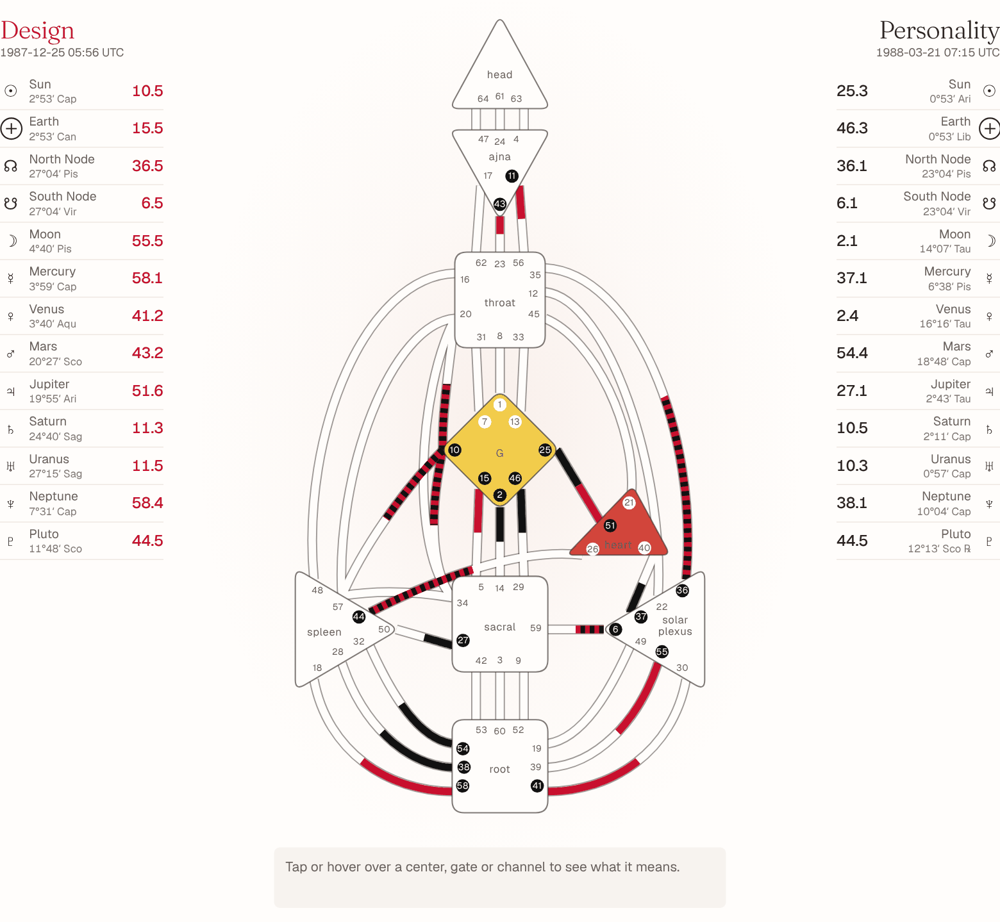

# Human Design Bodygraph skill

**Reference-level accuracy, tested on 10,000 charts, with the results published.**

An Agent Skill for Claude (and other agents that read `SKILL.md`) that calculates a Human Design chart from a
birth date, time and place and explains it in plain language. It can also compare two charts and make an
animated bodygraph page that assembles itself.



- **Accurate, and tested.** Planet positions match Swiss Ephemeris with NASA JPL DE431, the reference behind
  most Human Design software, to within one arcsecond. In a test of 10,000 random births, 9,998 charts were
  identical in every gate and line (the other 2 differed by one line of the Design Moon). In the same kind of
  test, the open-source engine pyhd had a wrong line in 0.65% of charts and called about 1 in 10 charts
  Generator where Jovian Archive's rules give Manifesting Generator. Full method and numbers:
  [accuracy](skills/human-design-bodygraph/references/accuracy.md).
- **Complete.** Type, strategy, authority, profile, definition, centers (defined, undefined, open), channels,
  all 26 activations with colour, tone and base, incarnation cross, Variables, and a birth-time check that
  tells how many minutes the time can be off before the chart changes.
- **Readable.** A reading for beginners: talents, work, relationships, life purpose, the centers, and a
  practical first step. No unexplained jargon.
- **No dependencies.** Node.js 18 or later. Works offline.

## Install

```
npx -y skills add 6h8w8j92vh-maker/human-design-bodygraph --skill human-design-bodygraph --agent claude-code
```

Or copy `skills/human-design-bodygraph` into `~/.claude/skills/` (all projects) or `.claude/skills/` (one project).

Then ask, for example: *"What is my Human Design? Born 21 March 1988, 08:15, Amsterdam."*

## Use the scripts directly

```
cd skills/human-design-bodygraph
node scripts/chart.js --date 1988-03-21 --time 08:15 --tz Europe/Amsterdam          # Markdown reading
node scripts/chart.js --date 1988-03-21 --time 08:15 --lat 52.37 --lon 4.89 --json  # JSON
node scripts/compare.js --a "1988-03-21 08:15 Europe/Amsterdam" --b "1948-04-09 00:14 America/Toronto"
node scripts/page.js --date 1988-03-21 --time 08:15 --tz Europe/Amsterdam --out bodygraph.html
```

`assets/bodygraph.html` also works on its own: open it, or link to it with
`?date=1988-03-21&time=08:15&tz=Europe/Amsterdam` to open with a chart.

## Fonts

Headlines are set in GT Super and text in Aeonik where those fonts are installed. They are commercial fonts
and not included; without them the page uses the free look-alikes Fraunces and Geist, which are built in.

## Develop

- `src/`: the page (`template.html`), chart logic (`core.js`), ephemeris (`ephemeris.js`, `ephdata.js`,
  `astronomia.js`), reading (`interpret.js`), cross names and towns (`data.js`), time zones (`tzlookup.js`).
- `python3 build.py` rebuilds `skills/human-design-bodygraph/assets/bodygraph.html` and `lib/`.
- `node test/published-charts.js` checks published charts.
- `tools/` rebuilds the ephemeris data; see the comments in each file.

## Notes

Human Design is a reflective framework, not a scientific test. Human Design is a trademark of Jovian Archive;
this project is independent and not affiliated. Licence: MIT, with third-party parts listed in
[NOTICE.md](NOTICE.md).
